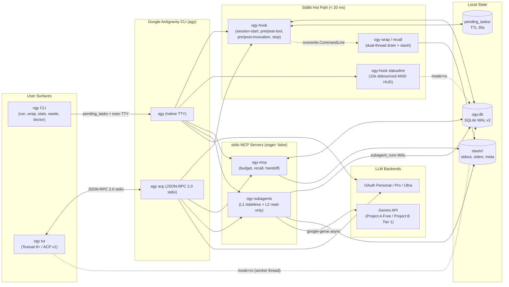

# Optigravity (`ogy`) — Technical Reference & Architecture

> Technical documentation for developers, maintainers, and contributors.  
> For installation, quick start, and usage instructions, see the [User Manual (`README.md`)](README.md).  
> For detailed A/B benchmark results and methodology, see [BENCHMARKS.md](BENCHMARKS.md).

---

## Table of Contents

1. [Global Architecture & Data Flow](#1-global-architecture--data-flow)
2. [Package Map & Packaging (`PEP 621`)](#2-package-map--packaging-pep-621)
3. [SQLite WAL Persistence & Data Model](#3-sqlite-wal-persistence--data-model)
4. [2-Stage Routing, Context Health & Pricing](#4-2-stage-routing-context-health--pricing)
5. [Fail-Open Hooks, Firebreaks & Shell Compression](#5-fail-open-hooks-firebreaks--shell-compression)
6. [Interactive ACP TUI Frontend (`ogy tui`)](#6-interactive-acp-tui-frontend-ogy-tui)
7. [MCP Servers (`ogy-mcp` & `ogy-subagents`)](#7-mcp-servers-ogy-mcp--ogy-subagents)
8. [State Files, Secrets & Configuration Precedence](#8-state-files-secrets--configuration-precedence)
9. [Development, Testing & Engineering Conventions](#9-development-testing--engineering-conventions)

---

## 1. Global Architecture & Data Flow

Optigravity (`ogy`) wraps around Google Antigravity CLI (`agy`) without ever modifying its binaries or intercepting its TTY through a PTY proxy. The architecture strictly separates a **100% stdlib V1 core** (`< 20 ms` latency, zero third-party dependencies) from **modular extensions** (ACP TUI, MCP servers, hybrid Gemini API subagents).



### Key Architectural Invariants

* **Zero PTY Proxy**: `ogy run` hands the native TTY directly to `agy` (`AGY_CLI_DISABLE_AUTO_UPDATE=true`, `OGY_TASK_ID`, `OGY_SESSION_META`).
* **100% Stdlib Hot Path**: `ogy_core`, `ogy_cli`, `ogy_hooks`, and `ogy_statusline` import no third-party libraries; optional extras (`mcp`, `textual`, `agent-client-protocol`, `google-genai`, `keyring`) are lazy-loaded with actionable install hints when absent.
* **Strict Fail-Open Hooks**: `ogy-hook` wraps `main()` in `try/except BaseException` so no hook exception can ever block `agy`.
* **ToS Section 6 Compliance**: orchestration actions in `ogy tui` (rotation, upgrade, delegation, switching Claude 5.5 to V1 `ogy run`) are always confirmed by the user with a single keystroke; `yolo` mode is explicitly banned on the ACP client side.

---

## 2. Package Map & Packaging (`PEP 621`)

The project uses `hatchling>=1.25.0` (`pyproject.toml`, Python `>=3.12`, version `0.2.0` exposed via `importlib.metadata` in `ogy_core.get_version()`).

### Packages & Responsibilities

| Package / Directory | Dependencies | Technical Role |
| :--- | :--- | :--- |
| `ogy_core/` | Stdlib only | Configuration (`config.py`), profile isolation & `.gemini` backup/restore (`profile.py`), SQLite WAL persistence & `W1`–`W8` detection (`storage.py`), `agy` transcript/DB ingestion (`ingest.py`), 2-stage routing (`router.py`), context health & handoff (`context_health.py`), versioned pricing (`pricing.py`), firebreaks & shell compression (`firebreaks.py`). |
| `ogy_cli/` | Stdlib only | `ogy` entry point (`main.py`), `ogy run` wrapper (`wrapper.py`), `init`/`uninstall`/`doctor`/`audit` wizard (`init_audit.py`), typed `config.toml` management (`config_cmd.py`), ROI `stats`/`waste` rendering (`stats_render.py`). |
| `ogy_hooks/` | Stdlib only | `ogy-hook` entry point (`cli.py`) dispatching `session-start`, `pre-tool`, `post-tool`, `pre-invocation`, `post-invocation`, `stop`, and `statusline`. |
| `ogy_statusline/` | Stdlib only | Terminal-width-adaptive 1-line ANSI HUD renderer, 10s SQLite debouncing, and `NO_COLOR` compliance (`render.py`). |
| `ogy_mcp/` | `[mcp]` (`mcp>=2,<3`) | Minimal stdio MCP server (`server.py`, 3 tools) with zero `stdout` writes. |
| `ogy_subagents/` | `[subagents]` (`mcp`, `google-genai[aiohttp]`, `keyring`) | Dedicated `ogy-subagents` MCP server (`server.py`), async `google-genai` client (`gemini_client.py`), 429/402 resilience router (`router.py`), secrets cascade & redaction (`secrets.py`), whitelisted read-only tools (`tools_readonly.py`), isolated `git worktree` runner (`worktree.py`). |
| `ogy_frontends/acp_tui/` | `[tui]` (`textual>=8.0`, `agent-client-protocol>=1.0`) | ACP v1 JSON-RPC 2.0 client (`client.py`), V2 orchestrator (`orchestrator.py`), FR/EN i18n (`i18n.py`), modular Textual app (`app.py`, `screens/`, `widgets/`, `state/`, `styles.tcss`). |
| `templates/` | Bundled in wheel (`ogy_cli/templates`) | Hygiene rule `ogy-hygiene.md` (< 200 tokens) and skill `ogy-frugal-engineering/SKILL.md`. |

### Entry Points & Extras (`pyproject.toml`)

```toml
[project.scripts]
ogy = "ogy_cli.main:main"
ogy-hook = "ogy_hooks.cli:main"
ogy-mcp = "ogy_mcp.server:main"
ogy-subagents = "ogy_subagents.server:main"
```

* `dependencies = []` — Base `.` install is 100% stdlib.
* Optional extras: `[mcp]`, `[tui]`, `[subagents]`, `[all]` (union of all three), `[dev]` (`pytest>=8.0`, `pytest-asyncio`).

---

## 3. SQLite WAL Persistence & Data Model

All local telemetry is centralized in `~/.local/share/optigravity/ogy.db` (overridable via `OGY_DB_PATH` or `[general].db_path`), managed by `ogy_core/storage.py`.

### Concurrency Strategy & PRAGMAs

* **WAL Mode & Initialization** (`DB_INIT_PRAGMAS`, applied during migrations):
  * `PRAGMA journal_mode = WAL;`
  * `PRAGMA auto_vacuum = INCREMENTAL;`
  * `PRAGMA journal_size_limit = 67108864;` (64 MiB)
* **Per-Connection PRAGMAs** (`CONN_PRAGMAS`, `isolation_level=None`):
  * `PRAGMA synchronous = NORMAL;`
  * `PRAGMA foreign_keys = ON;`
  * `PRAGMA busy_timeout = 5000;`
  * `PRAGMA temp_store = MEMORY;`
* **Versioned Migrations**: gated by `PRAGMA user_version` (`CURRENT_SCHEMA_VERSION = 2`) to avoid DDL locks on routine connections.
* **Lock-Free Reads (`connect_readonly`)**: `stats`, `waste`, the TUI telemetry worker, and the `statusline` fallback open the DB via URI `file://...?mode=ro` + `PRAGMA query_only = ON;` (zero write locks).
* **`stop` Maintenance**: `run_stop_maintenance()` runs a WAL checkpoint and incremental vacuum at session end.

### Relational Schema (9 Tables + 3 Views)

| Table | Primary Key / Idempotency Constraints | Role |
| :--- | :--- | :--- |
| `tasks` | `task_id` (PK) | Logical tasks (`repo_root`, `git_branch`, `category`, `outcome`, `verifier_passed`, `rollback_count`). |
| `sessions` | `session_id` (PK), FK `parent_session_id`, `task_id` | Session tree (`root_session_id`, `nesting_depth`), incremental ingestion cursors (`transcript_byte_offset`, `last_ingested_step`), aggregated costs. |
| `turns` | `turn_id` (PK), `UNIQUE(session_id, step_index)`, partial unique index `idx_turns_response_id` | Per-turn metrics: `input_tokens`, `cache_read_tokens`, `cache_creation_tokens`, `output_tokens`, `thinking_tokens`, `context_window_used`, `exceeds_200k`, `gap_since_prev_turn_s`, `estimated_cost_usd`. |
| `tool_calls` | `tool_call_id` (PK), `UNIQUE(session_id, step_index, tool_name, args_hash)` | Tool invocations deduplicated via `canonical_args_hash()` (compact sorted JSON SHA-256), `raw_output_bytes` vs `context_output_bytes`, `hook_action`, `firebreak_rule`, `is_error`. |
| `routing_decisions` | `decision_id` (PK), FK `session_id`, `task_id`, `escalated_from_id` | Stage 1 / Stage 2 routing history (`features_json`, `chosen_model`, `chosen_effort`, `propensity`, `predicted_score`, `actual_reward`). |
| `quota_snapshots` | `snapshot_id` (PK), index `(bucket_id, captured_at)` | OAuth quota snapshots (`remaining_fraction`, `reset_time`, `reset_in_seconds`, `plan_tier`). |
| `hook_events` | `event_id` (PK) | Audit log of hook invocations (`hook_type`, `action_taken`, `rule_name`, `tokens_saved_est`, `hook_latency_ms`). |
| `prompt_history` | `history_id` (PK), index `(repo_root, created_at DESC)` | Persistent TUI composer prompt history, scoped by repository. |
| `subagent_runs` | `run_id` (PK), FK `parent_session_id` | Real-time tracking of MCP subagents (`tool_name`, `model_id`, `tier`, `step`/`max_steps`, `status`, `input/output/thought_tokens`, `cost_usd`). |

**Analytical SQL Views:**
* `v_session_kpis`: per-session aggregation (`turn_count`, token totals, `cache_hit_ratio`, `peak_context_tokens`, `turns_cost_usd`).
* `v_task_rollup_with_subagents`: recursive CTE (`WITH RECURSIVE session_tree`, `depth < 10`) rolling up costs and tokens across a root session and its child sessions.
* `v_routing_performance`: success rate, mean reward, mean cost, and mean turn count by `(category, model_id, effort_level)` feeding the Stage 2 bandit.

### Atomic Correlation `ogy run` → `session-start`

To correlate a routing decision made before `agy` launches with the `conversationId` later assigned by `agy`, `write_pending_task()` writes an ephemeral JSON file (TTL `30 s`) to `~/.cache/optigravity/pending_tasks/<sha256(normcase(cwd))[:16]>.json` via atomic rename (`tmp.replace(target)`). On `session-start`, `consume_pending_task()` atomically claims the file (`target.replace(claimed)`), reads the decision, inserts the row into `routing_decisions`, and deletes the temporary file.

### Automated Waste Detection (`W1`–`W8`)

`detect_waste()` runs 8 targeted analytical queries:
* `W1`: low cache hit rate on warm sessions;
* `W2`: retry loops / repeated failing tool calls;
* `W3`: oversized tool outputs (`ogy wrap` candidates);
* `W4`: reasoning over-effort (disproportionate `thinking_tokens`);
* `W5`: context rot risk (high `peak_context_tokens` / long sessions);
* `W6`: duplicate reads of the same file;
* `W7`: MCP schema bloat (`eager: true` or UI-only tools);
* `W8`: subagent cost or step drift.

---

## 4. 2-Stage Routing, Context Health & Pricing

### 2-Stage Routing (`ogy_core/router.py`)

Optigravity enforces a **stickiness rule**: model and effort are chosen at session launch (or subagent boundary) and are never mutated mid-session without explicit user action, preserving the prompt cache prefix.

* **Stage 1 — Deterministic Heuristic (`< 5 ms`)**:
  * `extract_features()` extracts 8 normalized signals (`prompt_len`, `at_mentions`, `repo_file_count`, `has_test_runner`, `is_multifile`, `has_stacktrace`, `is_arch_sec`, `quota_low` when `remaining_fraction < 0.15`).
  * `classify_stage1()` maps to 7 categories:
    * `trivial_edit` → `(gemini-4-hydrogen, low, accept-edits)`
    * `lookup_qa` → `(gemini-4-hydrogen, low, plan)`
    * `routine_code` → `(gemini-4-hydrogen, medium, auto)`
    * `bugfix_local` → `(gemini-4-neon, low, auto)`
    * `bugfix_complex` → `(gemini-4-neon, high, auto)`
    * `refactor_multifile` → `(gemini-4-neon, medium, auto)`
    * `architecture_security` → `(gemini-4-neon, high, plan)`
  * When `quota_low` is true, effort steps down by one notch in `("low", "medium", "high", "xhigh")` (except for `architecture_security`).
* **Stage 2 — SQLite UCB1 Contextual Bandit**:
  * Activates only after `>= 15` qualified tasks in a category (`eta = 0.92`), excluding any arm with `< 80%` success rate.
  * Evaluable offline in shadow mode via `ogy router-eval`.

### Context Health & $K^*$ Threshold (`ogy_core/context_health.py`)

`assess_context_health()` classifies the session into three zones and recommends the most cost-effective action:

| Zone | Trigger Conditions | Recommended Action |
| :--- | :--- | :--- |
| **Green** | `< 60K` tokens, `< 15` turns, cache hit `>= 60%` | `keep_warm` |
| **Amber** | `60K–100K` tokens, or `15–25` turns, or cache `< 60%` (`>= 3` turns) | `frugal_btw` |
| **Red** | `>= 100K` tokens, or `exceeds_200k`, or `idle_gap > 180s` above `60K`, or `>= 2` consecutive failures | `rewind` (if `>= 2` failures), `compact` (if remaining turns `>= K*`, `<= 200K`, and `idle_gap <= 300s`), otherwise `clear_handoff` |

* **Break-Even Threshold $K^*$ (`k_star_threshold`)**: `5` remaining turns for Gemini, `9` turns for Claude (below this threshold, `/clear` + `.ogy/handoff.md` is `> 50%` cheaper than `/compact`).
* **Proactive Alerts**: Gemini cache pre-eviction at `idle_gap >= 150s`, cold cache at `>= 300s`, Haiku pricing cliff `> 90K` (5× at `100K`), and Gemini cliff `> 180K` (2× at `200K`).
* **Normalized Handoff (`write_handoff`)**: writes `.ogy/handoff.md` (`<= 30` structured lines: Goal, Modified files, Checks, Negative constraints, Next step), injected once via `injectSteps` on the next `session-start` and archived as `handoff.archived.md`.

### Versioned Pricing Catalogue (`ogy_core/pricing.py`)

* Alias normalization via `normalize_model_id()` (Gemini 4 `Hydrogen`/`Neon`/`Carbon`/`Argon`, Claude 5.5 `Opus`/`Sonnet`/`Haiku`, Gemini API `3.5-flash-lite`, `3.1-flash-lite`, `3.6/3.8-flash`, `3.1-pro`).
* **Built-In Pricing Switch Dates**:
  * `CARBON_PRICE_SWITCH_DATE = 2026-12-01` (`$2/$10` → `$4/$20` for Carbon/Argon).
  * `GEMINI_FLASH_PRICE_DOUBLE_DATE = 2027-01-01` (`$0.75/$3.75` → `$1.50/$7.50` for `3.6/3.8-flash`).
* **Exact Billing**: accounts for cache multipliers (`0.05` standard / `0.10` enterprise for Gemini; `0.05` read / `1.25` or `2.0` 1h write for Claude), long-context cliffs, `thoughts_token_count`, and strict `billing_source` separation (`oauth_quota`, `gemini_api_free`, `gemini_api_tier1`).

---

## 5. Fail-Open Hooks, Firebreaks & Shell Compression

### `ogy-hook` Dispatcher (`ogy_hooks/cli.py`)

Invoked by `agy` with the JSON payload on `stdin`, responds on `stdout`, and records its own latency in `hook_events` (`< 25 ms` target):
* `session-start`: registers the session, consumes `pending_tasks`, injects `.ogy/handoff.md` via `injectSteps`, and archives it.
* `pre-tool`: opens a `connect_readonly` connection (`timeout=0.5s`) and runs `evaluate_pre_tool_firebreaks()`. Always returns `{"decision": "allow"}` on pass-through (verified on `agy 1.5.16`), or `{"decision": "deny", "reason": ...}` / `{"decision": "allow", "overwrite": {"CommandLine": ...}}`.
* `post-tool`: normalizes `camelCase`/`snake_case` and records `tool_calls` (with `args_hash`).
* `pre-invocation` / `post-invocation`: incremental transcript ingestion (`ingest_transcript_incremental`), read-only enrichment from `agy`'s `conversations/<id>.db` (`enrich_from_agy_dbs`), and `budget.hard_cap_usd` enforcement.
* `stop`: reward calculation (`compute_reward`), session closure, and `run_stop_maintenance()`.

### Deterministic Firebreaks (`ogy_core/firebreaks.py`)

1. **Anti-Loop**: denies a call after `>= loop_threshold` (`3` by default) consecutive failures on the same `(session_id, tool_name, args_hash)`.
2. **Adaptive File Reads**:
   * Blocks lockfiles (`package-lock.json`, `yarn.lock`, `pnpm-lock.yaml`, `Cargo.lock`, `uv.lock`, `poetry.lock`, `composer.lock`, `Gemfile.lock`) unless bounded by a line range.
   * Extension-typed thresholds for unbounded reads: **48 KB** docs/config (`.md`, `.toml`, `.yaml`, `.txt`…), **24 KB** source code, **8 KB** logs/data (`.log`, `.json`, `.jsonl`, `.csv`, `.sql`, `.map`…). The denial message reports the exact file line count and tool-specific range parameters.
3. **Lexical Shell Tokenizer & `bounded-aware` Rewrite**:
   * Splits compound commands (`&&`, `||`, `;`, `|`) while preserving quotes; passes through redirections, subshells, PowerShell blocks, already-bounded commands (`pytest -q/--tb=short`, `git log -n/--oneline`, `git diff --stat`, `git status -s`, pipes into `head`/`tail`/`rg`/`jq`/`Select-Object`…), and mutating commands (`git commit/push/reset`, `rm`, `del`).
   * Honors explicit bypasses (`OGY_NO_WRAP=1`, `ogy raw --`).
   * When `hooks.overwrite_verified_ok = true`, silently rewrites verbose segments via `overwrite.CommandLine` to `ogy wrap -- <segment>`.

### Shell Compression (`ogy wrap` & `ogy recall`)

* **Deadlock-Free Dual-Thread Drain**: spawns the subprocess and drains `stdout` and `stderr` concurrently on two daemon threads (preventing OS pipe buffer deadlocks on Windows and POSIX) while preserving the exact exit code.
* **Transparent Pass-Through**: if output is `< 40` lines (`SMALL_OUTPUT_MAX_LINES`) and `< 3,072` bytes (`SMALL_OUTPUT_MAX_BYTES`), it is emitted verbatim.
* **Stash & LRU GC**: beyond those thresholds, writes `stdout.log`, `stderr.log`, and `meta.json` under `~/.cache/optigravity/stash/<hash>/` and returns a compact summary with the hash prefix. Opportunistic GC (every `3600 s`) purges entries exceeding `7 days` or `200 MB`.
* **TTY UX**: renders a 1-line spinner on `stderr` only when `stderr.isatty()`, emitting zero ANSI sequences in non-TTY mode.

---

## 6. Interactive ACP TUI Frontend (`ogy tui`)

Implemented in `ogy_frontends/acp_tui/` on **Textual 8+** and **`agent-client-protocol>=1.0`**.

### ACP v1 Client (`client.py`)

* Drives `agy acp` over JSON-RPC 2.0 on `stdio` with lifecycle management via `AsyncExitStack` (`process_per_session=True` by default).
* Strictly validates modes (`VALID_ACP_MODES = {"default", "accept-edits", "auto", "plan"}`, `BANNED_ACP_MODES = {"yolo"}`).
* Normalizes protocol events into frozen dataclasses (`slots=True`): `UserMessageEvent`, `AgentMessageEvent`, `AgentThoughtEvent`, `ToolCallEvent`, `UsageEvent`, `ConfigUpdateEvent`, `PermissionRequestEvent`.
* Ingests every ACP turn into `ogy.db` via `ingest_acp_turn()`.

### UI Architecture & Concurrency

| Module | Role |
| :--- | :--- |
| `app.py` | Textual lifecycle, global keybindings (`Ctrl+P/O/B/N/S/C/Q`, `F1`), slash command dispatch (`/model`, `/effort`, `/mode`, `/btw`, `/lang`, `/rotate`, `/handoff`, `/resume`), read-only SQLite worker `@work(thread=True, exclusive=True)`. |
| `screens/main.py` & `screens/modals.py` | Main layout (`ContentSwitcher` strictly isolating one `SessionTranscript` per `session_id`) and keyboard-first modals (`PermissionModal`, `ElicitationModal` form/url, `SessionPickerModal`, `HandoffReviewModal`). |
| `widgets/composer.py` | `PromptTextArea` (1–8 line auto-grow, `Ctrl+G` `$EDITOR`), SQLite prompt history (`↑`/`↓`, `Ctrl+R`), paste-collapse (`>= 8` lines or `>= 600` chars), async `@file` autocomplete (relative path only = 0 bloat). |
| `widgets/transcript.py` | Smooth streaming via `Markdown.get_stream()` + `Widget.anchor()`/`release_anchor()` (`↓ New messages · End` pill without scroll hijacking), collapsible `ActivityGroup` (`Ctrl+O`), `ToolCard` with colored unified diffs, auto-collapsing `ThoughtBlock`. |
| `widgets/telemetry.py` | Live sidebar: Context/Cache/OAuth Quota gauges, `parent → subagent` tree from `subagent_runs`, separate OAuth vs Gemini API USD counters. |
| `orchestrator.py` | `SessionOrchestrator`: Switch Tax calculation (`switch_tax_usd`), `> 60K` detection (`CACHE_PRESERVE_THRESHOLD`), Red Zone rotation, ToS Section 6 guardrail (`check_model_compatibility` redirecting Claude 5.5 OAuth to `ogy run`), `ActionProposal` emission. |

---

## 7. MCP Servers (`ogy-mcp` & `ogy-subagents`)

Both servers strictly adhere to the **MCP stdio** contract: no `print()` to `stdout`, all logs routed to `sys.stderr`, and `eager: false` registration in `mcp_config.json` (tagged `ogy-managed`).

### Minimal Server `ogy-mcp` (`ogy_mcp/server.py`)

Exposes 3 lightweight tools with compact schemas:
1. `ogy_session_budget(session_id?)` — reads `v_session_kpis` + latest turn, runs `assess_context_health()` and `detect_waste()`, returns the top 3 waste items and recommended action.
2. `ogy_recall(hash_prefix, start_line=1, end_line=100)` — bounded read from `~/.cache/optigravity/stash/`.
3. `ogy_write_handoff(...)` — generates `.ogy/handoff.md` (`<= 30` lines).

### Hybrid Server `ogy-subagents` (`ogy_subagents/`)

Offloads high-volume or read-only research tasks to the Gemini API (`gemini-3.5-flash-lite` by default) without touching the main agent's OAuth quotas.

* **Exposed Tools (all `readOnlyHint=True`)**:
  * **Level 1 (stateless, 0 disk/shell access)**: `ogy_summarize_stash(hash_prefix, focus_query?)`, `ogy_build_handoff(...)`.
  * **Level 2 (async `google-genai` loop, `max_steps=8`, `timeout=45s`)**: `ogy_research_repo(question, scope_paths?)`, `ogy_triage_failure(error_summary, stash_hash?)` using only whitelisted tools from `tools_readonly.py` (`rg_search`, `read_slice`, `list_files`, `git_status`), `store=False`, `thinking_level`, and preserved thought signatures.
* **429 / 402 Resilience & Privacy (`router.py`)**:
  * Physically separates **Project A (`free`)** and **Project B (`tier1`)** according to `subagents.privacy_mode` (`tier1_only`, `free_first`, `disabled`).
  * `classify_api_error()` distinguishes:
    * `rpm_tpm` (transient 429) → jittered exponential backoff (`1.5 s`, `4.0 s`).
    * `rpd` (daily quota 429) → circuit-breaker until midnight Pacific Time (`America/Los_Angeles`, UTC-8 fallback if `tzdata` is missing) and failover to Tier 1 when `free_first` + `fallback_to_tier1`.
    * `rpd_ambiguous` (429 without clear marker) → `15 min` cooldown.
    * `billing_402` → raises `SubagentBillingError` immediately (no retry).
* **Dual Progress Reporting (`_DualProgressReporter`)**: emits `ctx.report_progress` / `ctx.info` (throttled to `100 ms`) AND updates `subagent_runs` in SQLite WAL for the `ogy tui` sidebar.
* **Isolated `git worktree` Runner (`worktree.py`)**: strict opt-in (`subagents.worktree_enabled = false` by default), returning a structured JSON diff contract for human review.

---

## 8. State Files, Secrets & Configuration Precedence

### System Locations

| Artifact | Default Path | Notes |
| :--- | :--- | :--- |
| User configuration | `~/.config/optigravity/config.toml` | Managed via `ogy config show\|get\|set\|validate\|edit`. |
| API secrets (fallback) | `~/.config/optigravity/secrets.env` | Mode `0600` required on POSIX (`check_secrets_file_permissions`). |
| SQLite WAL database | `~/.local/share/optigravity/ogy.db` | Overridable via `OGY_DB_PATH` or `[general].db_path`. |
| `ogy wrap` stash | `~/.cache/optigravity/stash/<hash>/` | Contains `stdout.log`, `stderr.log`, `meta.json`. |
| `ogy run` correlation | `~/.cache/optigravity/pending_tasks/` | Ephemeral atomic files (TTL 30 s). |
| Ephemeral hook state | `<tempdir>/ogy-state/` | Statusline debounce and transient state. |
| `agy` integration | `~/.gemini/{antigravity-cli,config}/` (`shared` mode) or `~/.local/share/optigravity/gemini-profile/.gemini/` (`isolated` mode) | In `shared` mode: full snapshots `~/.local/share/optigravity/backups/<YYYYMMDD-HHMMSS>/` + `*.ogy.bak` + `OGY_ACTIVE=1` guard. In `isolated` mode: `~/.gemini/` stays 100% untouched, OAuth linked (symlink/hardlink/NTFS junction), `agy` launched with `--settings` + isolated `USERPROFILE`/`HOME`. |
| `agy` rules & skills | `.../config/rules/ogy-hygiene.md` & `.../config/skills/ogy-budget/SKILL.md` | Installed by `ogy init` into the active profile. |

### Configuration Precedence (`ogy_core/config.py`)

`OgyConfig defaults` < `~/.config/optigravity/config.toml` < environment variables (`OGY_DB_PATH`, `OGY_CONFIG_PATH`, `OGY_GEMINI_HOME`, `OGY_REAL_HOME`, `OGY_ACTIVE`, `OGY_LANGUAGE`, `OGY_NO_WRAP`).

### Secrets Resolution Cascade (`ogy_subagents/secrets.py`)

For each tier (`free` or `tier1`), `resolve_api_key()` queries in order:
1. **Environment variables**: `OGY_GEMINI_API_KEY_FREE` / `OGY_GEMINI_API_KEY_TIER1`, then `GEMINI_API_KEY` fallback.
2. **OS keyring (`keyring`)**: service `optigravity` (`gemini_api_key_free` / `gemini_api_key_tier1` / `gemini_api_key`), tolerant of SSH/headless environments.
3. **Local file**: `~/.config/optigravity/secrets.env` (rejected on POSIX if permissions `& 0o077 != 0`).

No key is ever written to `mcp_config.json` or logged: `RedactingFilter` masks any string matching `AIza[0-9A-Za-z_-]{35}` as `[REDACTED_GEMINI_KEY]`.

---

## 9. Development, Testing & Engineering Conventions

### Development Environment & Local Loop (`Justfile`)

```bash
# With uv (module mode recommended)
uv sync --all-extras
uv run -m pytest -q --tb=short

# Incremental local loop (cross-platform PowerShell + bash Justfile)
just dev          # uv run -m pytest --testmon -q --tb=short
just tui          # uv run -m pytest tests/test_tui_app.py tests/test_acp_client.py -q --tb=short
just v31          # uv run -m pytest -k "isolated or backup or restore or ogy_active" -q --tb=short
just snap-update  # uv run -m pytest -m snapshot --snapshot-update
just all          # uv run -m pytest -n auto --timeout=30 -q --tb=short
```

### Automated Test Pyramid V3.5 (4 Tiers)

The entire suite runs without ever invoking the real `agy` binary or consuming OAuth quotas. The global guard in `tests/conftest.py` isolates `HOME`/`USERPROFILE`, `OGY_DB_PATH`, `OGY_CONFIG_PATH`, and `OGY_GEMINI_HOME` inside `tmp_path`, guaranteeing zero pollution of the host `~/.gemini/` (including under `pytest-xdist` and `mutmut`).

1. **Tier 1 — Deterministic Core (`pytest` + `time-machine` + `inline-snapshot` + `syrupy`)**: SQLite WAL, `2026-12-01` / `2027-01-01` pricing switches, midnight PT RPD reset (`America/Los_Angeles`), 30s `pending_tasks` TTL, 10s statusline debounce, 7-day LRU purge, CLI/HUD/V3.1 snapshots.
2. **Tier 2 — Headless TUI & Real Protocols (`Pilot` + Fake ACP stdio + MCP stdio + Fake GenAI)**: `tests/fixtures/fake_acp_agent.py` (real JSON-RPC 2.0 over stdio, scenarios `nominal_stream`, `edit_with_diff_and_permission`, `elicitation_and_tos`, `faults_and_cancel`, `v31_env_audit`), in-memory MCP (`Client(app)`) + `stdout` purity and environment isolation on `ogy-mcp` / `ogy-subagents`, real `google.genai.errors.ClientError` (`429`/`402`/`400`) & `ServerError` (`5xx`), and `thought_signature` preservation.
3. **Tier 3 — Visual SVG Snapshots (`@pytest.mark.snapshot`, `pytest-textual-snapshot`)**: CSS/modal/sidebar rendering at `(80, 24)`, `(120, 36)`, and `(140, 40)` with frozen cursors (`disable_blink_for_active_cursors`) and frozen clock. Authoritative on `ubuntu-latest` in CI (visual HTML diff artifact on failure).
4. **Tier 4 — Real E2E Terminal (`@pytest.mark.e2e_tty`, POSIX PTY / ConPTY `pywinpty`) & Weekly Mutation (`mutmut v3`)**: `ogy wrap` TTY vs pipe spinner, `ogy run` TTY delegation & V3.1 simultaneous coexistence (`fake_agy_cli.py`), live `ogy tui` smoke test (`Ctrl+Q`), and weekly `mutation.yml` job (`ubuntu-latest`, `uv sync --all-extras --no-editable`) targeting `firebreaks.py`, `router.py`, `pricing.py`, `context_health.py`, `profile.py`, and `ogy_hooks/cli.py`.

### Test Suite Map (`tests/`)

| Test File | Coverage Scope |
| :--- | :--- |
| `tests/conftest.py` | Global isolation guard for `HOME`/`USERPROFILE`/`OGY_DB_PATH`/`OGY_GEMINI_HOME` + `make_tui_app` / `make_seeded_tui_app` factories (Textual #4998 safe). |
| `tests/fixtures/fake_acp_agent.py` | Deterministic stdio Fake ACP Agent (`acp.Agent`/`run_agent`) with 5 scenarios including `v31_env_audit`. |
| `tests/fixtures/fake_agy_cli.py` | Fake `agy` CLI for E2E TTY tests (`isatty()`, `OGY_ACTIVE`, `OGY_TASK_ID`, `--settings`). |
| `tests/test_storage.py` | WAL schema, `user_version` migrations, idempotent UPSERTs, KPI views, `pending_tasks`, `W1`–`W8` detection. |
| `tests/test_pricing_health.py` | Pricing catalogue, date switches (`2026-12-01`, `2027-01-01`), 100K/200K cliffs, Green/Amber/Red zones, $K^*$. |
| `tests/test_router_mcp.py` | Stage 1 / Stage 2 UCB1 routing, `ogy-mcp` tools. |
| `tests/test_firebreaks_wrap.py` | Anti-loop, typed thresholds, lexical shell tokenizer, `bounded-aware`, `ogy wrap`/`recall`, LRU GC. |
| `tests/test_hooks_statusline.py` | Fail-open `ogy-hook` contracts, `OGY_ACTIVE=1` vs pass-through, `injectSteps` handoff, `statusline` HUD rendering. |
| `tests/test_cli.py` | `ogy` commands (`init`, `uninstall`, `doctor`, `config`, `stats`, `waste`, `audit`, `backup`, `restore`, `run --dry-run`). |
| `tests/test_acp_client.py` | ACP v1 JSON-RPC 2.0 protocol (in-memory & stdio Fake ACP Agent), mode validation, `v31_env_audit`. |
| `tests/test_orchestrator_v2.py` | `SessionOrchestrator`, Switch Tax, ToS Section 6 guardrails, 1-key proposals. |
| `tests/test_tui_app.py` | Textual Pilot + stdio Fake ACP UI tests, `anchor()`/`release_anchor()` streaming (PR #6694), `paste-collapse`, modals, multi-session isolation. |
| `tests/test_tui_snapshots.py` | SVG visual snapshots (`@pytest.mark.snapshot`) for welcome, streaming + sidebar, and modals at `(80, 24)`, `(120, 36)`, `(140, 40)`. |
| `tests/test_mcp_integration.py` | In-memory MCP (`Client(app)`), JSON-RPC `stdout` purity, and V3.1 env isolation on `ogy-mcp` and `ogy-subagents`. |
| `tests/test_subagents_phase3.py` | `ogy-subagents` server, real `google.genai.errors` (`429`/`402`/`400`/`5xx`), `thought_signature`, secrets cascade, `worktree`. |
| `tests/test_cli_snapshots.py` | `time-machine` temporal tests, `inline-snapshot` + `dirty-equals` hook payloads, `syrupy` CLI/HUD/V3.1 outputs. |
| `tests/test_e2e_tty.py` | Real PTY/ConPTY E2E smoke tests (`@pytest.mark.e2e_tty`): `ogy wrap`, V3.1 `ogy run` coexistence, live `ogy tui`. |

### Engineering Rules for Contributions

1. **Zero third-party dependencies in `ogy_core`, `ogy_cli`, `ogy_hooks`, `ogy_statusline`**: any optional import must remain isolated in `ogy_mcp`, `ogy_subagents`, or `ogy_frontends` with an actionable error message.
2. **Zero `print()` on `stdout` in MCP servers and hooks**: `stdout` is strictly reserved for JSON-RPC frames / hook payloads; all diagnostics go to `sys.stderr`.
3. **Windows & POSIX portability**: normalize paths via `pathlib.Path`, never emit `~` or raw backslashes in JSON generated for `agy`, handle Windows ACLs on `secrets.env`, and use dual-thread draining on `subprocess.Popen`.
4. **Idempotency & reversibility**: every write to `~/.gemini/antigravity-cli/` by `ogy init` must create a `.ogy.bak` backup and tag its entries `ogy-managed` so `ogy uninstall` remains 100% non-destructive to other user extensions.
5. **Anti-regression rule & agent discipline**: any bug encountered once must be locked down by a new Fake ACP Agent scenario or a Pilot / `time-machine` / V3.1 isolation test (never repeat manual validations). Before finishing any task, always run `uv run -m pytest -q --tb=short` (or `just dev` while iterating).
