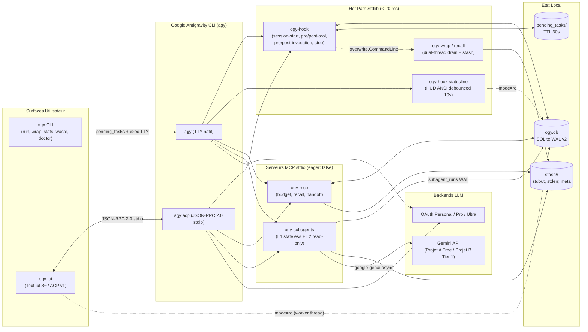

# Optigravity (`ogy`) — Référence Technique & Architecture

> Documentation technique destinée aux développeurs, mainteneurs et contributeurs.  
> Pour l'installation, le démarrage rapide et le guide d'utilisation, voir le [Manuel Utilisateur (`README.md`)](README.md).  
> Pour les résultats A/B détaillés et la méthodologie, voir [BENCHMARKS.md](BENCHMARKS.md).

---

## Table des matières

1. [Architecture globale & Flux de données](#1-architecture-globale--flux-de-données)
2. [Cartographie des packages & Packaging (`PEP 621`)](#2-cartographie-des-packages--packaging-pep-621)
3. [Persistance SQLite WAL & Modèle de données](#3-persistance-sqlite-wal--modèle-de-données)
4. [Routage 2-Étages, Santé du Contexte & Tarification](#4-routage-2-étages-santé-du-contexte--tarification)
5. [Hooks Fail-Open, Coupe-Feu & Compression Shell](#5-hooks-fail-open-coupe-feu--compression-shell)
6. [Frontend Interactif ACP TUI (`ogy tui`)](#6-frontend-interactif-acp-tui-ogy-tui)
7. [Serveurs MCP (`ogy-mcp` & `ogy-subagents`)](#7-serveurs-mcp-ogy-mcp--ogy-subagents)
8. [Fichiers d'état, Secrets & Précédence de configuration](#8-fichiers-détat-secrets--précédence-de-configuration)
9. [Développement, Tests & Conventions d'ingénierie](#9-développement-tests--conventions-dingénierie)

---

## 1. Architecture globale & Flux de données

Optigravity (`ogy`) s'insère autour de Google Antigravity CLI (`agy`) sans jamais modifier ses binaires ni intercepter son TTY via un proxy PTY. L'architecture sépare strictement un **noyau V1 100 % stdlib** (latence `< 20 ms`, zéro dépendance tierce) des **extensions modulaires** (TUI ACP, serveurs MCP, sous-agents hybrides Gemini API).



### Invariants architecturaux clés

* **Zero PTY Proxy** : `ogy run` délègue le TTY natif directement à `agy` (`AGY_CLI_DISABLE_AUTO_UPDATE=true`, `OGY_TASK_ID`, `OGY_SESSION_META`).
* **Hot path 100 % stdlib** : `ogy_core`, `ogy_cli`, `ogy_hooks` et `ogy_statusline` n'importent aucune bibliothèque tierce ; les extras (`mcp`, `textual`, `agent-client-protocol`, `google-genai`, `keyring`) sont chargés paresseusement (*lazy imports*) avec message d'installation explicite en cas d'absence.
* **Fail-open absolu sur les hooks** : `ogy-hook` encapsule `main()` dans `try/except BaseException` afin qu'aucune exception ne bloque jamais `agy`.
* **Conformité ToS Section 6** : les actions d'orchestration dans `ogy tui` (rotation, upgrade, délégation, bascule Claude 5.5 vers V1 `ogy run`) sont toujours confirmées par l'utilisateur en une touche ; le mode `yolo` est explicitement banni côté client ACP.

---

## 2. Cartographie des packages & Packaging (`PEP 621`)

Le projet utilise `hatchling>=1.25.0` (`pyproject.toml`, Python `>=3.12`, version `0.2.0` exposée via `importlib.metadata` dans `ogy_core.get_version()`).

### Packages & responsabilités

| Package / Répertoire | Dépendances | Rôle technique |
| :--- | :--- | :--- |
| `ogy_core/` | Stdlib uniquement | Configuration (`config.py`), isolation profil & backup/restore `.gemini` (`profile.py`), persistance SQLite WAL & détection `W1`–`W8` (`storage.py`), ingestion transcripts/DBs `agy` (`ingest.py`), routage 2-étages (`router.py`), santé du contexte & handoff (`context_health.py`), tarification versionnée (`pricing.py`), coupe-feu & compression shell (`firebreaks.py`). |
| `ogy_cli/` | Stdlib uniquement | Point d'entrée `ogy` (`main.py`), wrapper `ogy run` (`wrapper.py`), assistant `init`/`uninstall`/`doctor`/`audit` (`init_audit.py`), gestion typée de `config.toml` (`config_cmd.py`), rendu ROI `stats`/`waste` (`stats_render.py`). |
| `ogy_hooks/` | Stdlib uniquement | Point d'entrée `ogy-hook` (`cli.py`) dispatchant `session-start`, `pre-tool`, `post-tool`, `pre-invocation`, `post-invocation`, `stop` et `statusline`. |
| `ogy_statusline/` | Stdlib uniquement | Rendu HUD 1 ligne ANSI adaptatif à la largeur du terminal, debouncing SQLite 10 s et respect `NO_COLOR` (`render.py`). |
| `ogy_mcp/` | `[mcp]` (`mcp>=2,<3`) | Serveur MCP stdio minimal (`server.py`, 3 outils) sans aucune écriture sur `stdout`. |
| `ogy_subagents/` | `[subagents]` (`mcp`, `google-genai[aiohttp]`, `keyring`) | Serveur MCP dédié `ogy-subagents` (`server.py`), client async `google-genai` (`gemini_client.py`), routeur de résilience 429/402 (`router.py`), cascade de secrets & redaction (`secrets.py`), outils read-only whitelistés (`tools_readonly.py`), runner isolé `git worktree` (`worktree.py`). |
| `ogy_frontends/acp_tui/` | `[tui]` (`textual>=8.0`, `agent-client-protocol>=1.0`) | Client ACP v1 JSON-RPC 2.0 (`client.py`), orchestrateur V2 (`orchestrator.py`), i18n FR/EN (`i18n.py`), application Textual modulaire (`app.py`, `screens/`, `widgets/`, `state/`, `styles.tcss`). |
| `templates/` | Inclus dans le wheel (`ogy_cli/templates`) | Règle d'hygiène `ogy-hygiene.md` (< 200 tokens) et skill `ogy-frugal-engineering/SKILL.md`. |

### Points d'entrée & Extras (`pyproject.toml`)

```toml
[project.scripts]
ogy = "ogy_cli.main:main"
ogy-hook = "ogy_hooks.cli:main"
ogy-mcp = "ogy_mcp.server:main"
ogy-subagents = "ogy_subagents.server:main"
```

* `dependencies = []` — Installation de base `.` 100 % stdlib.
* Extras optionnels : `[mcp]`, `[tui]`, `[subagents]`, `[all]` (union des trois), `[dev]` (`pytest>=8.0`, `pytest-asyncio`).

---

## 3. Persistance SQLite WAL & Modèle de données

Toute la télémétrie locale est centralisée dans `~/.local/share/optigravity/ogy.db` (surchargeable via `OGY_DB_PATH` ou `[general].db_path`), gérée par `ogy_core/storage.py`.

### Stratégie de concurrence & PRAGMAs

* **Mode WAL & initialisation** (`DB_INIT_PRAGMAS`, appliqués lors des migrations) :
  * `PRAGMA journal_mode = WAL;`
  * `PRAGMA auto_vacuum = INCREMENTAL;`
  * `PRAGMA journal_size_limit = 67108864;` (64 Mio)
* **PRAGMAs par connexion** (`CONN_PRAGMAS`, `isolation_level=None`) :
  * `PRAGMA synchronous = NORMAL;`
  * `PRAGMA foreign_keys = ON;`
  * `PRAGMA busy_timeout = 5000;`
  * `PRAGMA temp_store = MEMORY;`
* **Migrations versionnées** : contrôlées par `PRAGMA user_version` (`CURRENT_SCHEMA_VERSION = 2`) afin d'éviter tout verrou DDL sur les connexions courantes.
* **Lectures sans contention (`connect_readonly`)** : `stats`, `waste`, le worker TUI et le fallback `statusline` ouvrent la base via URI `file://...?mode=ro` + `PRAGMA query_only = ON;` (zéro verrou d'écriture).
* **Maintenance `stop`** : `run_stop_maintenance()` exécute un checkpoint WAL et un vacuum incrémental en fin de session.

### Schéma relationnel (9 tables + 3 vues)

| Table | Clé primaire / Contraintes d'idempotence | Rôle |
| :--- | :--- | :--- |
| `tasks` | `task_id` (PK) | Tâches logiques (`repo_root`, `git_branch`, `category`, `outcome`, `verifier_passed`, `rollback_count`). |
| `sessions` | `session_id` (PK), FK `parent_session_id`, `task_id` | Arbre de sessions (`root_session_id`, `nesting_depth`), curseurs d'ingestion incrémentale (`transcript_byte_offset`, `last_ingested_step`), coûts agrégés. |
| `turns` | `turn_id` (PK), `UNIQUE(session_id, step_index)`, index unique partiel `idx_turns_response_id` | Métriques par tour : `input_tokens`, `cache_read_tokens`, `cache_creation_tokens`, `output_tokens`, `thinking_tokens`, `context_window_used`, `exceeds_200k`, `gap_since_prev_turn_s`, `estimated_cost_usd`. |
| `tool_calls` | `tool_call_id` (PK), `UNIQUE(session_id, step_index, tool_name, args_hash)` | Appels d'outils dédupliqués via `canonical_args_hash()` (SHA-256 JSON trié compact), volumes `raw_output_bytes` vs `context_output_bytes`, `hook_action`, `firebreak_rule`, `is_error`. |
| `routing_decisions` | `decision_id` (PK), FK `session_id`, `task_id`, `escalated_from_id` | Historique des décisions Stage 1 / Stage 2 (`features_json`, `chosen_model`, `chosen_effort`, `propensity`, `predicted_score`, `actual_reward`). |
| `quota_snapshots` | `snapshot_id` (PK), index `(bucket_id, captured_at)` | Instantanés des quotas OAuth (`remaining_fraction`, `reset_time`, `reset_in_seconds`, `plan_tier`). |
| `hook_events` | `event_id` (PK) | Audit des déclenchements hooks (`hook_type`, `action_taken`, `rule_name`, `tokens_saved_est`, `hook_latency_ms`). |
| `prompt_history` | `history_id` (PK), index `(repo_root, created_at DESC)` | Historique persistant des prompts du compositeur TUI, filtré par dépôt. |
| `subagent_runs` | `run_id` (PK), FK `parent_session_id` | Suivi temps réel des sous-agents MCP (`tool_name`, `model_id`, `tier`, `step`/`max_steps`, `status`, `input/output/thought_tokens`, `cost_usd`). |

**Vues SQL analytiques :**
* `v_session_kpis` : agrégation par session (`turn_count`, totaux tokens, `cache_hit_ratio`, `peak_context_tokens`, `turns_cost_usd`).
* `v_task_rollup_with_subagents` : CTE récursive (`WITH RECURSIVE session_tree`, `depth < 10`) consolidant les coûts et tokens d'une session racine et de ses sessions enfants.
* `v_routing_performance` : taux de succès, récompense moyenne, coût moyen et nombre moyen de tours par `(category, model_id, effort_level)` pour alimenter le bandit Stage 2.

### Corrélation atomique `ogy run` → `session-start`

Pour relier une décision de routage prise avant le lancement de `agy` au `conversationId` attribué ensuite par `agy`, `write_pending_task()` écrit un fichier JSON éphémère (TTL `30 s`) dans `~/.cache/optigravity/pending_tasks/<sha256(normcase(cwd))[:16]>.json` via renommage atomique (`tmp.replace(target)`). À l'événement `session-start`, `consume_pending_task()` revendique le fichier atomiquement (`target.replace(claimed)`), lit la décision, enregistre la ligne dans `routing_decisions` puis supprime le fichier temporaire.

### Détection automatisée du gaspillage (`W1`–`W8`)

`detect_waste()` exécute 8 requêtes analytiques ciblées :
* `W1` : faible taux de cache hit sur sessions chaudes ;
* `W2` : boucles de retries / appels en erreur répétés ;
* `W3` : sorties d'outils obèses (candidates `ogy wrap`) ;
* `W4` : sur-effort de raisonnement (`thinking_tokens` disproportionnés) ;
* `W5` : risque de *context rot* (`peak_context_tokens` élevé / longs tours) ;
* `W6` : lectures redondantes du même fichier ;
* `W7` : surcharge de schémas MCP (`eager: true` ou outils UI-only) ;
* `W8` : dérive de coût ou d'étapes des sous-agents.

---

## 4. Routage 2-Étages, Santé du Contexte & Tarification

### Routage 2-Étages (`ogy_core/router.py`)

Optigravity applique la **règle de stickiness** : le modèle et l'effort sont fixés au lancement de la session (ou à la frontière d'un sous-agent) et ne sont jamais modifiés à la volée sans action explicite, afin de préserver le préfixe de prompt cache.

* **Stage 1 — Heuristique déterministe (`< 5 ms`)** :
  * `extract_features()` extrait 8 signaux normalisés (`prompt_len`, `at_mentions`, `repo_file_count`, `has_test_runner`, `is_multifile`, `has_stacktrace`, `is_arch_sec`, `quota_low` si `remaining_fraction < 0.15`).
  * `classify_stage1()` mappe vers 7 catégories :
    * `trivial_edit` → `(gemini-4-hydrogen, low, accept-edits)`
    * `lookup_qa` → `(gemini-4-hydrogen, low, plan)`
    * `routine_code` → `(gemini-4-hydrogen, medium, auto)`
    * `bugfix_local` → `(gemini-4-neon, low, auto)`
    * `bugfix_complex` → `(gemini-4-neon, high, auto)`
    * `refactor_multifile` → `(gemini-4-neon, medium, auto)`
    * `architecture_security` → `(gemini-4-neon, high, plan)`
  * Si `quota_low` est vrai, l'effort est abaissé d'un cran dans `("low", "medium", "high", "xhigh")` (sauf pour `architecture_security`).
* **Stage 2 — Bandit contextuel UCB1 sur SQLite** :
  * S'active uniquement à partir de `>= 15` tâches qualifiées dans une catégorie (`eta = 0.92`), en excluant tout bras dont le taux de succès est `< 80 %`.
  * Évaluable hors ligne en mode shadow via `ogy router-eval`.

### Santé du contexte & seuil $K^*$ (`ogy_core/context_health.py`)

`assess_context_health()` classe la session en trois zones et recommande l'action la plus économique :

| Zone | Conditions de déclenchement | Action recommandée |
| :--- | :--- | :--- |
| **Green** | `< 60K` tokens, `< 15` tours, cache hit `>= 60 %` | `keep_warm` |
| **Amber** | `60K–100K` tokens, ou `15–25` tours, ou cache `< 60 %` (`>= 3` tours) | `frugal_btw` |
| **Red** | `>= 100K` tokens, ou `exceeds_200k`, ou `idle_gap > 180s` au-dessus de `60K`, ou `>= 2` échecs consécutifs | `rewind` (si `>= 2` échecs), `compact` (si tours restants `>= K*`, `<= 200K` et `idle_gap <= 300s`), sinon `clear_handoff` |

* **Seuil de rentabilité $K^*$ (`k_star_threshold`)** : `5` tours restants pour Gemini, `9` tours pour Claude (en dessous, `/clear` + `.ogy/handoff.md` est `> 50 %` moins cher que `/compact`).
* **Alertes proactives** : pré-éviction cache Gemini à `idle_gap >= 150s`, cache froid à `>= 300s`, falaise tarifaire Haiku `> 90K` (5× à `100K`) et Gemini `> 180K` (2× à `200K`).
* **Handoff normalisé (`write_handoff`)** : écrit `.ogy/handoff.md` (`<= 30` lignes structurées : Goal, Modified files, Checks, Negative constraints, Next step), injecté une seule fois via `injectSteps` au `session-start` suivant puis archivé en `handoff.archived.md`.

### Catalogue tarifaire versionné (`ogy_core/pricing.py`)

* Normalisation des alias via `normalize_model_id()` (Gemini 4 `Hydrogen`/`Neon`/`Carbon`/`Argon`, Claude 5.5 `Opus`/`Sonnet`/`Haiku`, Gemini API `3.5-flash-lite`, `3.1-flash-lite`, `3.6/3.8-flash`, `3.1-pro`).
* **Dates de bascule tarifaire intégrées** :
  * `CARBON_PRICE_SWITCH_DATE = 2026-12-01` (`$2/$10` → `$4/$20` pour Carbon/Argon).
  * `GEMINI_FLASH_PRICE_DOUBLE_DATE = 2027-01-01` (`$0.75/$3.75` → `$1.50/$7.50` pour `3.6/3.8-flash`).
* **Facturation exacte** : prise en compte des multiplicateurs de cache (`0.05` standard / `0.10` enterprise pour Gemini ; `0.05` read / `1.25` ou `2.0` write 1h pour Claude), falaises long-contexte, `thoughts_token_count`, et séparation stricte des sources (`oauth_quota`, `gemini_api_free`, `gemini_api_tier1`).

---

## 5. Hooks Fail-Open, Coupe-Feu & Compression Shell

### Dispatcher `ogy-hook` (`ogy_hooks/cli.py`)

Invoqué par `agy` avec le payload JSON sur `stdin`, il répond sur `stdout` et mesure sa propre latence dans `hook_events` (cible `< 25 ms`) :
* `session-start` : crée la session, consomme `pending_tasks`, injecte `.ogy/handoff.md` via `injectSteps` puis l'archive.
* `pre-tool` : ouvre une connexion `connect_readonly` (`timeout=0.5s`) et évalue `evaluate_pre_tool_firebreaks()`. Retourne toujours `{"decision": "allow"}` en pass-through (contrat validé sur `agy 1.5.16`), ou `{"decision": "deny", "reason": ...}` / `{"decision": "allow", "overwrite": {"CommandLine": ...}}`.
* `post-tool` : normalise `camelCase`/`snake_case`, enregistre `tool_calls` (avec `args_hash`).
* `pre-invocation` / `post-invocation` : ingestion incrémentale des transcripts (`ingest_transcript_incremental`), enrichissement lecture seule depuis les bases `conversations/<id>.db` de `agy` (`enrich_from_agy_dbs`), contrôle de `budget.hard_cap_usd`.
* `stop` : calcul de la récompense (`compute_reward`), clôture session et `run_stop_maintenance()`.

### Coupe-feu déterministes (`ogy_core/firebreaks.py`)

1. **Anti-loop** : refuse un appel après `>= loop_threshold` (`3` par défaut) échecs consécutifs sur le même `(session_id, tool_name, args_hash)`.
2. **Lectures de fichiers adaptatives** :
   * Blocage des lockfiles (`package-lock.json`, `yarn.lock`, `pnpm-lock.yaml`, `Cargo.lock`, `uv.lock`, `poetry.lock`, `composer.lock`, `Gemfile.lock`) sans plage de lignes bornée.
   * Seuils typés par extension sur les lectures non bornées : **48 Ko** docs/config (`.md`, `.toml`, `.yaml`, `.txt`…), **24 Ko** code source, **8 Ko** logs/données (`.log`, `.json`, `.jsonl`, `.csv`, `.sql`, `.map`…). Le message de refus indique le nombre exact de lignes et les paramètres de plage adaptés à l'outil.
3. **Tokenizer lexical shell & réécriture `bounded-aware`** :
   * Découpe les commandes composées (`&&`, `||`, `;`, `|`) en préservant les guillemets, laisse passer les redirections, sous-shells, blocs PowerShell et commandes déjà bornées (`pytest -q/--tb=short`, `git log -n/--oneline`, `git diff --stat`, `git status -s`, pipes vers `head`/`tail`/`rg`/`jq`/`Select-Object`…), ainsi que les commandes mutantes (`git commit/push/reset`, `rm`, `del`).
   * Respecte le bypass explicite (`OGY_NO_WRAP=1`, `ogy raw --`).
   * Si `hooks.overwrite_verified_ok = true`, réécrit silencieusement les segments verbeux via `overwrite.CommandLine` en `ogy wrap -- <segment>`.

### Compression shell (`ogy wrap` & `ogy recall`)

* **Drainage dual-thread sans deadlock** : lance le sous-processus et draine `stdout` et `stderr` en parallèle dans deux threads daemon (évite les deadlocks de buffers OS sur Windows et POSIX) tout en préservant le code de sortie exact.
* **Pass-through transparent** : si la sortie fait `< 40` lignes (`SMALL_OUTPUT_MAX_LINES`) et `< 3 072` octets (`SMALL_OUTPUT_MAX_BYTES`), elle est renvoyée telle quelle.
* **Stash & GC LRU** : au-delà, écrit `stdout.log`, `stderr.log` et `meta.json` sous `~/.cache/optigravity/stash/<hash>/` et retourne un résumé compact avec le préfixe de hash. Un GC opportuniste (toutes les `3600 s`) purge les entrées au-delà de `7 jours` ou `200 Mo`.
* **UX TTY** : spinner 1 ligne sur `stderr` uniquement si `stderr.isatty()`, zéro séquence ANSI en mode non-TTY.

---

## 6. Frontend Interactif ACP TUI (`ogy tui`)

Implémenté dans `ogy_frontends/acp_tui/` sur **Textual 8+** et **`agent-client-protocol>=1.0`**.

### Client ACP v1 (`client.py`)

* Pilote `agy acp` en JSON-RPC 2.0 sur `stdio` avec gestion du cycle de vie via `AsyncExitStack` (`process_per_session=True` par défaut).
* Valide strictement les modes (`VALID_ACP_MODES = {"default", "accept-edits", "auto", "plan"}`, `BANNED_ACP_MODES = {"yolo"}`).
* Normalise le flux protocole en dataclasses figées (`slots=True`) : `UserMessageEvent`, `AgentMessageEvent`, `AgentThoughtEvent`, `ToolCallEvent`, `UsageEvent`, `ConfigUpdateEvent`, `PermissionRequestEvent`.
* Ingère chaque tour ACP dans `ogy.db` via `ingest_acp_turn()`.

### Architecture UI & Concurrence

| Module | Rôle |
| :--- | :--- |
| `app.py` | Cycle de vie Textual, raccourcis globaux (`Ctrl+P/O/B/N/S/C/Q`, `F1`), dispatch des commandes slash (`/model`, `/effort`, `/mode`, `/btw`, `/lang`, `/rotate`, `/handoff`, `/resume`), worker SQLite lecture seule `@work(thread=True, exclusive=True)`. |
| `screens/main.py` & `screens/modals.py` | Layout principal (`ContentSwitcher` isolant strictement un `SessionTranscript` par `session_id`) et modales clavier-first (`PermissionModal`, `ElicitationModal` form/url, `SessionPickerModal`, `HandoffReviewModal`). |
| `widgets/composer.py` | `PromptTextArea` (1–8 lignes auto-grow, `Ctrl+G` `$EDITOR`), historique SQLite (`↑`/`↓`, `Ctrl+R`), paste-collapse (`>= 8` lignes ou `>= 600` caractères), autocomplétion asynchrone `@file` (chemin relatif seul = 0 bloat). |
| `widgets/transcript.py` | Streaming fluide via `Markdown.get_stream()` + `Widget.anchor()`/`release_anchor()` (pilule `↓ New messages · End` sans hijack du scroll), `ActivityGroup` repliable (`Ctrl+O`), `ToolCard` avec diffs unifiés colorés, `ThoughtBlock` auto-repliable. |
| `widgets/telemetry.py` | Sidebar live : jauges Context/Cache/Quotas OAuth, arbre `parent → subagent` depuis `subagent_runs`, compteurs séparés OAuth vs Gemini API USD. |
| `orchestrator.py` | `SessionOrchestrator` : calcul de *Switch Tax* (`switch_tax_usd`), détection `> 60K` (`CACHE_PRESERVE_THRESHOLD`), rotation Zone Rouge, garde-fou ToS Section 6 (`check_model_compatibility` redirigeant Claude 5.5 OAuth vers `ogy run`), émission d'`ActionProposal`. |

---

## 7. Serveurs MCP (`ogy-mcp` & `ogy-subagents`)

Les deux serveurs respectent strictement le contrat **MCP stdio** : aucun `print()` sur `stdout`, logs routés vers `sys.stderr`, et enregistrement `eager: false` dans `mcp_config.json` (tag `ogy-managed`).

### Serveur minimal `ogy-mcp` (`ogy_mcp/server.py`)

Expose 3 outils légers à schéma compact :
1. `ogy_session_budget(session_id?)` — lit `v_session_kpis` + dernier tour, exécute `assess_context_health()` et `detect_waste()`, retourne le top 3 waste et l'action conseillée.
2. `ogy_recall(hash_prefix, start_line=1, end_line=100)` — lecture bornée dans `~/.cache/optigravity/stash/`.
3. `ogy_write_handoff(...)` — génère `.ogy/handoff.md` (`<= 30` lignes).

### Serveur hybride `ogy-subagents` (`ogy_subagents/`)

Déporte les tâches volumineuses ou de recherche en lecture seule vers la Gemini API (`gemini-3.5-flash-lite` par défaut) sans toucher aux quotas OAuth de l'agent principal.

* **Outils exposés (tous `readOnlyHint=True`)** :
  * **Niveau 1 (stateless, 0 accès disque/shell)** : `ogy_summarize_stash(hash_prefix, focus_query?)`, `ogy_build_handoff(...)`.
  * **Niveau 2 (boucle async `google-genai`, `max_steps=8`, `timeout=45s`)** : `ogy_research_repo(question, scope_paths?)`, `ogy_triage_failure(error_summary, stash_hash?)` utilisant uniquement les outils whitelistés de `tools_readonly.py` (`rg_search`, `read_slice`, `list_files`, `git_status`), `store=False`, `thinking_level` et préservation des *thought signatures*.
* **Résilience 429 / 402 & Confidentialité (`router.py`)** :
  * Sépare physiquement **Projet A (`free`)** et **Projet B (`tier1`)** selon `subagents.privacy_mode` (`tier1_only`, `free_first`, `disabled`).
  * `classify_api_error()` distingue :
    * `rpm_tpm` (429 transitoire) → backoff exponentiel jitter (`1.5 s`, `4.0 s`).
    * `rpd` (429 quota journalier) → circuit-breaker jusqu'à minuit Pacific Time (`America/Los_Angeles`, fallback UTC-8 si `tzdata` absent) et bascule vers Tier 1 si `free_first` + `fallback_to_tier1`.
    * `rpd_ambiguous` (429 sans marqueur clair) → cooldown `15 min`.
    * `billing_402` → lève `SubagentBillingError` immédiatement (aucun retry).
* **Double reporting de progression (`_DualProgressReporter`)** : émet `ctx.report_progress` / `ctx.info` (throttlé à `100 ms`) ET met à jour la table `subagent_runs` en SQLite WAL pour la sidebar `ogy tui`.
* **Exécuteur isolé `git worktree` (`worktree.py`)** : opt-in strict (`subagents.worktree_enabled = false` par défaut), retourne un contrat JSON de diff pour revue humaine.

---

## 8. Fichiers d'état, Secrets & Précédence de configuration

### Emplacements système

| Artefact | Chemin par défaut | Notes |
| :--- | :--- | :--- |
| Configuration utilisateur | `~/.config/optigravity/config.toml` | Gérée via `ogy config show\|get\|set\|validate\|edit`. |
| Secrets API (fallback) | `~/.config/optigravity/secrets.env` | Mode `0600` exigé sur POSIX (`check_secrets_file_permissions`). |
| Base SQLite WAL | `~/.local/share/optigravity/ogy.db` | Surchargeable via `OGY_DB_PATH` ou `[general].db_path`. |
| Stash `ogy wrap` | `~/.cache/optigravity/stash/<hash>/` | Contient `stdout.log`, `stderr.log`, `meta.json`. |
| Corrélation `ogy run` | `~/.cache/optigravity/pending_tasks/` | Fichiers atomiques éphémères (TTL 30 s). |
| État temporaire hooks | `<tempdir>/ogy-state/` | Debounce statusline et états éphémères. |
| Intégration `agy` | `~/.gemini/{antigravity-cli,config}/` (mode `shared`) ou `~/.local/share/optigravity/gemini-profile/.gemini/` (mode `isolated`) | En mode `shared` : snapshots complets `~/.local/share/optigravity/backups/<YYYYMMDD-HHMMSS>/` + `*.ogy.bak` + garde-fou `OGY_ACTIVE=1`. En mode `isolated` : `~/.gemini/` 100 % vierge, OAuth lié (symlink/hardlink/jonction NTFS), `agy` lancé avec `--settings` + `USERPROFILE`/`HOME` isolés. |
| Règles & skills `agy` | `.../config/rules/ogy-hygiene.md` & `.../config/skills/ogy-budget/SKILL.md` | Injecté par `ogy init` dans le profil actif. |

### Précédence de configuration (`ogy_core/config.py`)

`défauts OgyConfig` < `~/.config/optigravity/config.toml` < variables d'environnement (`OGY_DB_PATH`, `OGY_CONFIG_PATH`, `OGY_GEMINI_HOME`, `OGY_REAL_HOME`, `OGY_ACTIVE`, `OGY_LANGUAGE`, `OGY_NO_WRAP`).

### Cascade de résolution des secrets (`ogy_subagents/secrets.py`)

Pour chaque tier (`free` ou `tier1`), `resolve_api_key()` interroge dans l'ordre :
1. **Variables d'environnement** : `OGY_GEMINI_API_KEY_FREE` / `OGY_GEMINI_API_KEY_TIER1`, puis fallback `GEMINI_API_KEY`.
2. **Trousseau OS (`keyring`)** : service `optigravity` (`gemini_api_key_free` / `gemini_api_key_tier1` / `gemini_api_key`), tolérant aux environnements SSH/headless.
3. **Fichier local** : `~/.config/optigravity/secrets.env` (refusé sur POSIX si permissions `& 0o077 != 0`).

Aucune clé n'est jamais écrite dans `mcp_config.json` ni journalisée : `RedactingFilter` masque toute chaîne correspondant à `AIza[0-9A-Za-z_-]{35}` par `[REDACTED_GEMINI_KEY]`.

---

## 9. Développement, Tests & Conventions d'ingénierie

### Environnement de développement & Boucle locale (`Justfile`)

```bash
# Avec uv (mode module recommandé)
uv sync --all-extras
uv run -m pytest -q --tb=short

# Boucle locale incrémentale (Justfile cross-platform PowerShell + bash)
just dev          # uv run -m pytest --testmon -q --tb=short
just tui          # uv run -m pytest tests/test_tui_app.py tests/test_acp_client.py -q --tb=short
just v31          # uv run -m pytest -k "isolated or backup or restore or ogy_active" -q --tb=short
just snap-update  # uv run -m pytest -m snapshot --snapshot-update
just all          # uv run -m pytest -n auto --timeout=30 -q --tb=short
```

### Pyramide de tests automatisés V3.5 (4 étages)

L'ensemble de la suite tourne sans jamais invoquer le binaire réel `agy` ni consommer de quotas OAuth. Le garde-fou global `tests/conftest.py` isole systématiquement `HOME`/`USERPROFILE`, `OGY_DB_PATH`, `OGY_CONFIG_PATH` et `OGY_GEMINI_HOME` dans `tmp_path` pour garantir zéro pollution du `~/.gemini/` hôte (y compris sous `pytest-xdist` et `mutmut`).

1. **Étage 1 — Noyau déterministe (`pytest` + `time-machine` + `inline-snapshot` + `syrupy`)** : SQLite WAL, bascules tarifaires `2026-12-01` / `2027-01-01`, reset RPD minuit PT (`America/Los_Angeles`), TTL `pending_tasks` 30 s, debounce statusline 10 s, purge LRU 7 j, snapshots CLI/HUD/V3.1.
2. **Étage 2 — TUI Headless & Protocoles réels (`Pilot` + Fake ACP stdio + MCP stdio + Fake GenAI)** : `tests/fixtures/fake_acp_agent.py` (JSON-RPC 2.0 réel sur stdio, scénarios `nominal_stream`, `edit_with_diff_and_permission`, `elicitation_and_tos`, `faults_and_cancel`, `v31_env_audit`), MCP en mémoire (`Client(app)`) + pureté `stdout` et isolation d'environnement sur `ogy-mcp` / `ogy-subagents`, vraies exceptions `google.genai.errors.ClientError` (`429`/`402`/`400`) & `ServerError` (`5xx`) et préservation `thought_signature`.
3. **Étage 3 — Snapshots visuels SVG (`@pytest.mark.snapshot`, `pytest-textual-snapshot`)** : rendu CSS/modales/sidebar en `(80, 24)`, `(120, 36)` et `(140, 40)` avec curseurs figés (`disable_blink_for_active_cursors`) et horloge gelée. Autoritaire sur `ubuntu-latest` en CI (artefact HTML visuel en cas d'échec).
4. **Étage 4 — Terminal E2E réel (`@pytest.mark.e2e_tty`, PTY POSIX / ConPTY `pywinpty`) & Mutation hebdomadaire (`mutmut v3`)** : spinner `ogy wrap` TTY vs pipe, délégation TTY `ogy run` & coexistence simultanée V3.1 (`fake_agy_cli.py`), smoke test `ogy tui` live (`Ctrl+Q`), et job hebdomadaire `mutation.yml` (`ubuntu-latest`, `uv sync --all-extras --no-editable`) ciblant `firebreaks.py`, `router.py`, `pricing.py`, `context_health.py`, `profile.py` et `ogy_hooks/cli.py`.

### Cartographie de la suite de tests (`tests/`)

| Fichier de test | Périmètre couvert |
| :--- | :--- |
| `tests/conftest.py` | Garde-fou global d'isolation `HOME`/`USERPROFILE`/`OGY_DB_PATH`/`OGY_GEMINI_HOME` + factories `make_tui_app` / `make_seeded_tui_app` (sûr Textual #4998). |
| `tests/fixtures/fake_acp_agent.py` | Fake ACP Agent déterministe sur stdio (`acp.Agent`/`run_agent`) avec 5 scénarios dont `v31_env_audit`. |
| `tests/fixtures/fake_agy_cli.py` | Fake `agy` CLI pour les tests E2E TTY (`isatty()`, `OGY_ACTIVE`, `OGY_TASK_ID`, `--settings`). |
| `tests/test_storage.py` | Schéma WAL, migrations `user_version`, UPSERTs idempotents, vues KPI, `pending_tasks`, détection `W1`–`W8`. |
| `tests/test_pricing_health.py` | Catalogue tarifaire, bascules de dates (`2026-12-01`, `2027-01-01`), falaises 100K/200K, zones Green/Amber/Red, $K^*$. |
| `tests/test_router_mcp.py` | Routage Stage 1/Stage 2 UCB1, outils `ogy-mcp`. |
| `tests/test_firebreaks_wrap.py` | Anti-loop, seuils typés, tokenizer lexical shell, `bounded-aware`, `ogy wrap`/`recall`, GC LRU. |
| `tests/test_hooks_statusline.py` | Contrats fail-open `ogy-hook`, `OGY_ACTIVE=1` vs pass-through, `injectSteps` handoff, rendu HUD `statusline`. |
| `tests/test_cli.py` | Commandes `ogy` (`init`, `uninstall`, `doctor`, `config`, `stats`, `waste`, `audit`, `backup`, `restore`, `run --dry-run`). |
| `tests/test_acp_client.py` | Protocole ACP v1 JSON-RPC 2.0 (in-memory & Fake ACP Agent stdio), validation des modes, `v31_env_audit`. |
| `tests/test_orchestrator_v2.py` | `SessionOrchestrator`, *Switch Tax*, garde-fous ToS Section 6, propositions 1 touche. |
| `tests/test_tui_app.py` | Tests UI Textual Pilot + Fake ACP stdio, streaming `anchor()`/`release_anchor()` (PR #6694), `paste-collapse`, modales, multi-sessions. |
| `tests/test_tui_snapshots.py` | Snapshots visuels SVG (`@pytest.mark.snapshot`) sur accueil, streaming + sidebar et modales en `(80, 24)`, `(120, 36)`, `(140, 40)`. |
| `tests/test_mcp_integration.py` | MCP en mémoire (`Client(app)`), pureté `stdout` JSON-RPC et isolation d'env V3.1 sur `ogy-mcp` et `ogy-subagents`. |
| `tests/test_subagents_phase3.py` | Serveur `ogy-subagents`, vraies exceptions `google.genai.errors` (`429`/`402`/`400`/`5xx`), `thought_signature`, cascade secrets, `worktree`. |
| `tests/test_cli_snapshots.py` | Tests temporels `time-machine`, payloads hooks `inline-snapshot` + `dirty-equals`, sorties CLI/HUD/V3.1 `syrupy`. |
| `tests/test_e2e_tty.py` | Smoke tests E2E en vrai terminal PTY/ConPTY (`@pytest.mark.e2e_tty`) : `ogy wrap`, `ogy run` coexistence V3.1, `ogy tui` live. |

### Règles d'ingénierie pour toute contribution

1. **Zéro dépendance tierce dans `ogy_core`, `ogy_cli`, `ogy_hooks`, `ogy_statusline`** : tout import optionnel doit rester isolé dans `ogy_mcp`, `ogy_subagents` ou `ogy_frontends` avec un message d'erreur actionnable.
2. **Zéro `print()` sur `stdout` dans les serveurs MCP et les hooks** : `stdout` est réservé aux trames JSON-RPC / payloads hooks ; tout diagnostic passe par `sys.stderr`.
3. **Portabilité Windows & POSIX** : chemins normalisés via `pathlib.Path`, jamais de `~` ni de backslash nu dans les JSON générés pour `agy`, gestion des ACL Windows sur `secrets.env`, drainage dual-thread sur `subprocess.Popen`.
4. **Idempotence & réversibilité** : toute écriture dans `~/.gemini/antigravity-cli/` par `ogy init` doit créer un backup `.ogy.bak` et taguer ses entrées `ogy-managed` afin que `ogy uninstall` reste 100 % non destructif pour les autres extensions utilisateur.
5. **Règle d'ingénierie anti-régression & discipline agents** : chaque bug constaté une fois doit être verrouillé par un nouveau scénario du Fake ACP Agent ou un test Pilot / `time-machine` / isolation V3.1 (aucune validation manuelle déjà effectuée ne doit être à refaire). Avant toute fin de tâche, exécuter systématiquement `uv run -m pytest -q --tb=short` (ou `just dev` pendant l'itération).
